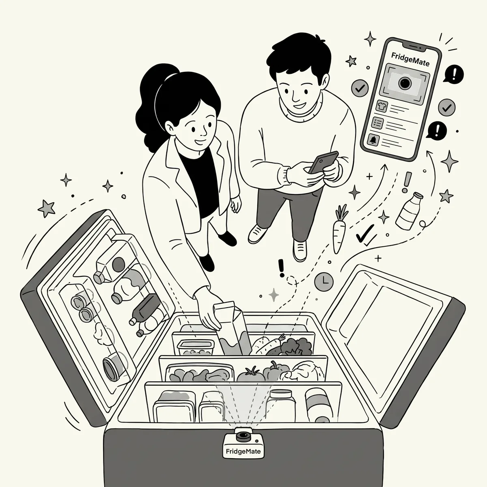
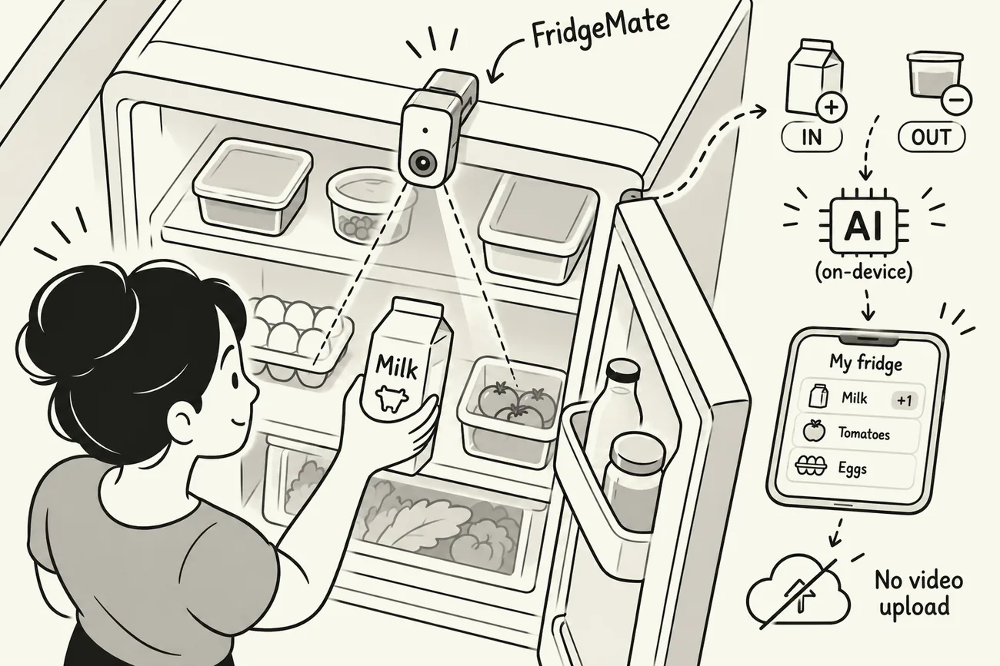
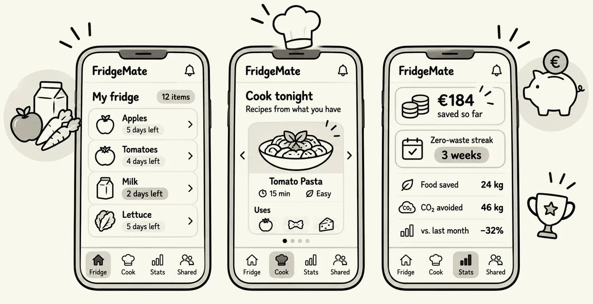

<div align="center">

# FridgeMate

**A portable camera for any fridge.**

*Your old fridge finally knows who's coming and going.*

[**Landing page**](https://simo-hue.github.io/EIT-Food-Challenge-Hackathon-2026/) &nbsp;·&nbsp; [**Try the demo**](https://simo-hue.github.io/EIT-Food-Challenge-Hackathon-2026/app/) &nbsp;·&nbsp; [**Pitch presentation**](https://canva.link/lr0zkipg547op9a)

<br>



<br>

EIT Food Challenge Labs Hungary 2026 · Budapest

</div>

---

> FridgeMate is a concept at prototype stage. The demo uses simulated data: there is no real camera, account or server behind it.

## The problem

EU households throw away **69 kg of food per person a year**. Most of it is not carelessness. Food gets pushed to the back of the fridge, forgotten, and found too late. Smart fridges that track food exist, but they cost thousands of euros.

## The idea

FridgeMate is a portable clip-on camera plus an app that turns any ordinary fridge into a smart one.

| | |
|---|---|
| **Portable** | It clips on top of any fridge. Unclip it and take it to your next one. |
| **In and out** | One narrow camera watches the doorway and logs every item going in and out, so nothing gets lost at the back. |
| **On-device AI** | Recognition runs on the device itself. |
| **No video upload** | No video leaves the fridge. |

<div align="center">

</div>

## The app

| Tab | What it does |
|---|---|
| **Fridge** | Everything you have, sorted by what expires first, with a warning before food goes off. |
| **Cook** | Meals from what is already in the fridge, starting with what expires soonest. |
| **Stats** | What you saved, in money and in food, with streaks for zero-waste weeks. |
| **Shared** | Name tags for shared fridges: mine, or free for everyone. |

<div align="center">

</div>

## Price and impact

| | |
|---|---|
| **€49** | The portable camera, once (target price). |
| **€5 a month** | The app (target price). |
| **Up to 50%** | Less food waste at home. This is our target, to prove in a pilot. |
| **€180–200 a year** | Saved per household. Also a target, not yet a result. |

## Try it

- **Landing page:** <https://simo-hue.github.io/EIT-Food-Challenge-Hackathon-2026/>
- **Demo app:** <https://simo-hue.github.io/EIT-Food-Challenge-Hackathon-2026/app/>
- **Pitch presentation (Canva):** <https://canva.link/lr0zkipg547op9a>

In the demo, long-press the FridgeMate logo (or press `C` on a laptop) to simulate the camera seeing a new item. "Reset demo" is under the three dots. On a phone, "Add to Home Screen" opens it full screen, and it keeps working offline after the first visit.

## What's in this repo

| Path | Contents |
|---|---|
| [`docs/`](docs/) | The website: landing page and demo app, served by GitHub Pages. See [`docs/README.md`](docs/README.md) for how to edit it. |
| [`FridgeMate_Final.md`](FridgeMate_Final.md) | Product concept and business model, with sources. |
| [`Presentation.pptx.pptx`](Presentation.pptx.pptx) | The pitch deck as a PowerPoint file. |
| [`PRESENTATION ASSETS/`](PRESENTATION%20ASSETS/) | Illustrations used in the deck and on the site. |
| [`CONCEPTS/`](CONCEPTS/) | Earlier concept notes. |
| [`BRAINSTORMING IMGS/`](BRAINSTORMING%20IMGS/) | Photos from the brainstorming sessions. |

The site is plain HTML, CSS and JavaScript with no build step. To run it locally:

```
cd docs
python3 -m http.server 8000
```

Then open <http://localhost:8000/>.

## Team

**Simone · Saeed · Kostya**

Built at EIT Food Challenge Labs Hungary 2026, Budapest.
